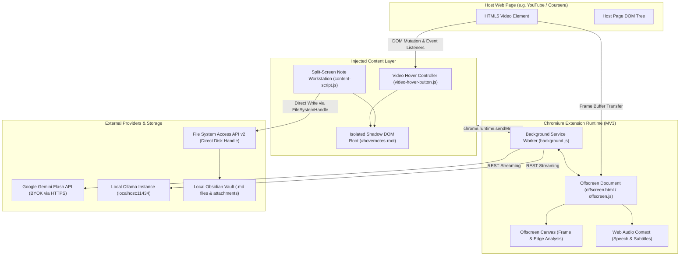
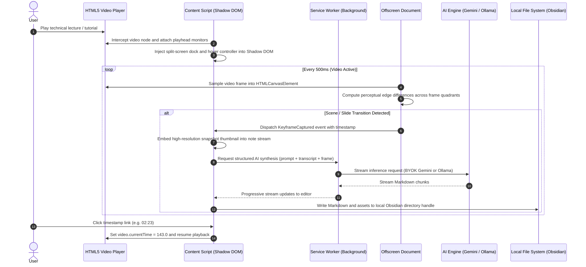

# Yrusika: Open-Source AI Video Note-Taking Workstation (Chromium Extension)

[](https://opensource.org/licenses/MIT)
[](https://github.com/tejuas98/yrusika)
[](https://github.com/tejuas98/yrusika)
[](manifest.json)

Yrusika is an open-source, client-side video note-taking workstation and visual transcriber built as a Chromium browser extension (Google Chrome, Brave, Arc, Microsoft Edge). It docks directly alongside HTML5 video players (YouTube, Coursera, Udemy), detects slide changes and code keyframes via client-side computer vision, and streams structured, timestamped Markdown notes directly into your local Obsidian vault or file system.

All processing occurs client-side. There are zero subscriptions, zero telemetry, zero intermediate servers, and zero vendor lock-in.

---

## Table of Contents

- [System Architecture](#system-architecture)
  - [Component Architecture](#component-architecture)
  - [Runtime Data Flow](#runtime-data-flow)
- [Technical Breakdown of Working](#technical-breakdown-of-working)
  - [1. DOM Interception and Shadow DOM Isolation](#1-dom-interception-and-shadow-dom-isolation)
  - [2. Computer-Vision Keyframe and Scene Detection Pipeline](#2-computer-vision-keyframe-and-scene-detection-pipeline)
  - [3. Offscreen Document Processing](#3-offscreen-document-processing)
  - [4. Direct AI Inference and Streaming Pipeline (BYOK)](#4-direct-ai-inference-and-streaming-pipeline-byok)
  - [5. Storage Engine and Direct Obsidian Vault Sync](#5-storage-engine-and-direct-obsidian-vault-sync)
  - [6. In-Video Controller and Player Telemetry](#6-in-video-controller-and-player-telemetry)
- [Tech Stack](#tech-stack)
- [Codebase Anatomy](#codebase-anatomy)
- [Installation and Developer Setup](#installation-and-developer-setup)
- [Configuration and API Setup](#configuration-and-api-setup)
- [Keyboard Shortcuts](#keyboard-shortcuts)
- [Security and Privacy Model](#security-and-privacy-model)
- [License](#license)

---

## System Architecture

### Component Architecture



### Runtime Data Flow



---

## Technical Breakdown of Working

### 1. DOM Interception and Shadow DOM Isolation

Web applications like YouTube, Udemy, and Coursera employ complex CSS styling and strict stacking contexts that interfere with standard injected browser extension UI. Yrusika solves this using an isolated Web Components architecture:

* **Shadow DOM Encapsulation:** The note-taking sidebar and floating action buttons are mounted under a closed Shadow Root (`#hovernotes-root`). Host page stylesheets cannot bleed into the extension, and Yrusika's CSS rules (`hn-shadow.css`) cannot distort host page styling.
* **Layout Rebalancing (Split-Screen):** When Focus Mode is toggled, `content-script.js` dynamically modifies the layout container of the host page (such as `#primary`, `#player-container-outer`, or `#player-theater-container` on YouTube). The video element is contracted to an optimal viewing width (typically 60-65%), while the Yrusika workstation docks directly into the remaining horizontal space (35-40%).
* **Fullscreen Awareness:** The extension hooks into the `fullscreenchange` and `webkitfullscreenchange` browser APIs to seamlessly toggle between embedded dock mode and native cinema mode without losing note state.

### 2. Computer-Vision Keyframe and Scene Detection Pipeline

Rather than relying on manual user screenshots, Yrusika executes client-side computer-vision scene change detection:

1. **Frame Capture Sampling:** Video playhead frames are sampled into an internal `HTMLCanvasElement` at regular intervals (1 to 2 frames per second when seeking, 0.5 FPS during playback).
2. **Quadrant Edge Analysis:** The canvas frame is downscaled to a normalized matrix (e.g., 320x180) to minimize CPU overhead. The frame is subdivided into 4 quadrants.
3. **Difference Thresholding:** A luminosity and color difference coefficient is computed between successive frames:
   $$D = \frac{1}{N} \sum_{i=1}^{N} |P_{t}(i) - P_{t-1}(i)|$$
   If $D$ exceeds the adaptive sensitivity threshold (accounting for video noise and minor speaker motion while picking up slide transitions, diagram draws, or code editor changes), a **Keyframe Trigger** is dispatched.
4. **Timestamp Anchoring:** The captured image is immediately tagged with the exact `video.currentTime` and embedded into the live Markdown session.

### 3. Offscreen Document Processing

Manifest V3 disallows background service workers from accessing the DOM, creating `<canvas>` elements, or managing raw `AudioContext` buffers. Yrusika implements the Chromium `chrome.offscreen` API:

* `background.js` checks for an active offscreen document via `chrome.offscreen.hasDocument()`.
* If absent, it spawns `offscreen.html` with reason `BLOBS` and `USER_MEDIA`.
* Heavy computational tasks (such as image encoding, WebP compression, transcript alignment, and audio buffer analysis) are offloaded to `offscreen.js`, preventing any frame drops or UI thread latency on the host video page.

### 4. Direct AI Inference and Streaming Pipeline (BYOK)

Yrusika functions entirely on a **Bring Your Own Key (BYOK)** model:

* **Google Gemini Integration:** Connects directly to the Google AI Studio Gemini API (`gemini-2.5-flash` or `gemini-1.5-pro`). Users provide their free API key (which includes 1,500 free requests per day). Requests are dispatched via standard `fetch()` using the `streamGenerateContent` endpoint.
* **Local Ollama Integration:** For air-gapped, privacy-sensitive, or offline study sessions, Yrusika connects to a local Ollama server (`http://localhost:11434/api/generate`). It transmits visual keyframes and audio transcript prompts directly to locally hosted vision-language models (such as `llava`, `llama3.2-vision`, or `mistral`).
* **Progressive Markdown Rendering:** The response stream is piped directly into the note workstation editor, allowing users to read notes as they are generated without waiting for multi-paragraph completions.

### 5. Storage Engine and Direct Obsidian Vault Sync

Yrusika bypasses third-party cloud sync by interacting directly with the user's local file system:

* **File System Access API v2:** Utilizing `showDirectoryPicker()`, users grant Yrusika read/write access to their Obsidian vault directory. The returned `FileSystemDirectoryHandle` is stored persistently in `indexedDB`.
* **Zero-Intermediary Saving:** Whenever a note is generated or edited, `local-file-system-v2.js` and `file-registry.js` write the Markdown file directly to `<Vault>/Yrusika/<Video-Title>.md`, while saving keyframe images to `<Vault>/Yrusika/assets/<timestamp>.webp`.
* **Obsidian URI Fallback:** If the browser or environment restricts direct file system handles, Yrusika falls back to the native Obsidian URI protocol handler:
  `obsidian://new?vault=MyVault&name=LectureNotes&content=...`
  This guarantees compatibility across various configurations.

### 6. In-Video Controller and Player Telemetry

A floating controller HUD is rendered over the video player (`video-hover-button.js`):

* **Playback Speed Regulation:** One-click shortcuts for slow study (`0.8x`), standard (`1.0x`), study burst (`1.5x`), and user-defined high speed (`1.8x` to `2.5x`).
* **Frame Step Seeking:** Frame-accurate stepping using keyboard shortcuts (`Z` for -10s, `X` for +10s) and direct playhead scrub triggers.
* **YouTube Ad Intelligence:** Monitors player state transitions to prevent keyframe capture during pre-roll and mid-roll commercials, resuming note capture only when actual lecture content plays.

---

## Tech Stack

| Layer | Technologies and Libraries |
| :--- | :--- |
| **Extension Platform** | Chromium Manifest V3 (Chrome 116+, Brave, Arc, Microsoft Edge) |
| **Frontend Architecture** | Vanilla ES6+ TypeScript/JavaScript, Web Components, Shadow DOM |
| **Styling & Isolation** | Scoped CSS (`hn-inject.css`, `hn-shadow.css`), CSS Custom Properties |
| **Extension APIs** | `chrome.tabs`, `chrome.runtime`, `chrome.offscreen`, `chrome.storage.local`, `chrome.contextMenus` |
| **Graphics & Vision** | HTML5 Canvas 2D Context, WebCodecs API, Perceptual Quadrant Hashing |
| **Storage & I/O** | File System Access API v2 (`FileSystemHandle`), IndexedDB, `chrome.storage.sync` |
| **AI Integration** | Google Gemini REST API (Server-Sent Events streaming), Ollama Native REST API |
| **External Integration**| Obsidian URI Protocol (`obsidian://`), Markdown Serialization |
| **Internationalization**| Native Chromium `_locales` subsystem (58 language packs supported) |

---

## Codebase Anatomy

```
yrusika/
├── manifest.json              # Extension Manifest V3 metadata, host permissions, and scripts
├── background.js              # Service Worker: tab events, offscreen management, proxy calls
├── content-script.js          # Core injected script: viewport splitting, note editor, UI orchestrator
├── video-hover-button.js      # In-player floating HUD: speed control, playhead tracking, quick actions
├── offscreen.html             # Offscreen DOM host container for background processing
├── offscreen.js               # Offscreen worker: canvas frame extraction, edge detection, audio buffer
├── local-file-system-v2.js    # File System Access API v2 manager: directory handles and file writes
├── file-registry.js           # File handle cache, duplicate prevention, and asset registration
├── save-to-obsidian.js        # Obsidian URI protocol builder and Markdown export generator
├── browser-polyfill.min.js    # Cross-browser WebExtensions API compatibility layer
├── hover-notes-utils.js       # Shared utility helpers (debouncing, timestamp formatters, sanitize)
├── unlock-pro.js              # Feature registry ensuring 100% features remain unlocked and free
├── string-utils.js            # Text manipulation and Markdown formatting helpers
├── hn-inject.css              # Host-page styles for viewport resizing and dock placement
├── hn-shadow.css              # Isolated styles applied inside the Shadow DOM component tree
├── options.html               # Extension settings interface (AI prompts, shortcuts, themes)
├── options.js                 # Settings controller and API key storage logic
├── options.css                # Styling for the options and configuration page
├── popup.html                 # Browser toolbar action popup
├── popup.js                   # Popup interactions and quick-launch trigger
├── popup.css                  # Toolbar popup styling
├── _locales/                  # 58 language localization directories (en, es, zh, ja, de, etc.)
└── assets/                    # Icons, robot mascot badges, and architecture diagrams
```

---

## Installation and Developer Setup

### Prerequisites
* Any Chromium-based browser (Google Chrome, Brave, Arc, Microsoft Edge).
* A free [Google AI Studio API Key](https://aistudio.google.com/) or local [Ollama](https://ollama.ai/).

### Manual Developer Installation

1. **Clone the repository:**
   ```bash
   git clone https://github.com/tejuas98/yrusika.git
   ```

2. **Open Extensions Manager:**
   In your Chromium browser, navigate to:
   ```
   chrome://extensions/
   ```

3. **Enable Developer Mode:**
   Toggle the **Developer mode** switch in the top-right corner.

4. **Load the Extension:**
   * Click **Load unpacked** in the top-left toolbar.
   * Select the root `/yrusika` directory containing `manifest.json`.

5. **Verify Installation:**
   Yrusika will appear in your extension list. Pin it to your browser toolbar for quick access.

---

## Configuration and API Setup

1. Click the **Yrusika** icon in your browser toolbar or right-click the extension and select **Options**.
2. **AI Provider Configuration:**
   * **Google Gemini (Recommended):** Paste your free API key from Google AI Studio. Gemini 2.5 Flash is selected by default for rapid multi-modal inference.
   * **Local Ollama:** Select the Ollama provider option, ensure Ollama is running (`ollama run llama3.2-vision`), and verify the endpoint (`http://localhost:11434`).
3. **Obsidian Vault Binding:**
   * In the Yrusika sidebar, click the **Vault** indicator.
   * Select your local Obsidian vault folder using the native directory picker.
   * Grant write permissions so notes and frame captures save directly to disk.

---

## Keyboard Shortcuts

| Shortcut Key | Action |
| :--- | :--- |
| `R` | Reset video playback speed to `1.0x` |
| `G` | Jump to preferred study speed (`1.8x`) |
| `Z` | Rewind video by 10 seconds |
| `X` | Fast-forward video by 10 seconds |
| `V` | Toggle floating in-video controller bar visibility |
| `/` | Open Markdown slash commands inside note editor |
| `Esc` | Exit Video Mode and restore standard browser layout |

*(All shortcut keys can be customized in the extension settings page).*

---

## Security and Privacy Model

* **Zero Tracking:** Yrusika contains no tracking pixels, analytics scripts, or remote telemetry probes.
* **Direct Connections Only:** AI requests originate directly from your browser to Google AI Studio or your local Ollama port. No proxy servers exist between your browser and your AI model.
* **Local Data Sovereignty:** Notes, transcripts, and captured images are written directly to your local file system or local browser storage (`chrome.storage.local`).
* **Source Transparency:** All extension source code is human-readable, unminified JavaScript licensed under MIT.

---

## License

This project is licensed under the [MIT License](LICENSE) — free for personal, educational, and commercial use.
