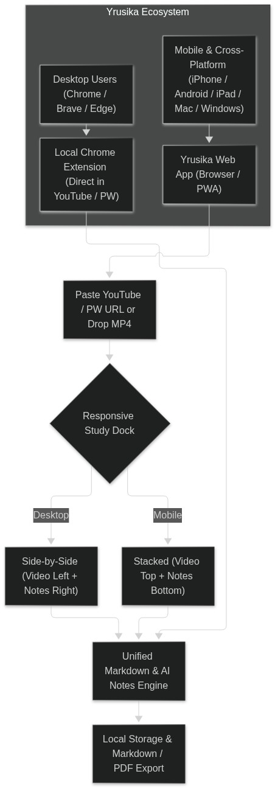
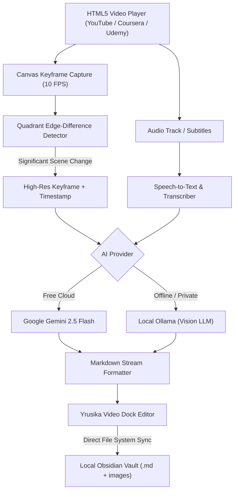

# Yrusika — Open-Source AI Video Note Taker & Visual Transcriber

[](https://opensource.org/licenses/MIT)
[](https://github.com/tejuas98/yrusika)
[](https://github.com/tejuas98/yrusika)

**Yrusika** is a 100% free, open-source AI video note-taking workstation and visual transcriber for Chrome and Chromium browsers. It docks directly alongside YouTube, Coursera, Udemy, and any HTML5 video player, runs real-time computer-vision scene detection, captures high-resolution lecture slides and code keyframes, and streams structured, timestamped Markdown directly into your local Obsidian vault or files.

Zero subscriptions, zero paywalls, zero vendor tracking. Bring your own free Google Gemini API key or run completely offline with local Ollama models.

---

## Table of Contents

- [Why Yrusika?](#why-yrusika)
- [Complete Feature Breakdown](#complete-feature-breakdown)
  - [1. Focus Mode & Split-Screen Dock](#1-focus-mode--split-screen-dock)
  - [2. Comprehensive Video Mode Settings](#2-comprehensive-video-mode-settings)
  - [3. In-Video Controller Bar](#3-in-video-controller-bar)
  - [4. Dock Footer Action Toolbar](#4-dock-footer-action-toolbar)
  - [5. Obsidian Vault & Local File System Sync](#5-obsidian-vault--local-file-system-sync)
  - [6. Rich Markdown Editor & Slash Commands](#6-rich-markdown-editor--slash-commands)
  - [7. Interactive Video Transcripts & Seeking](#7-interactive-video-transcripts--seeking)
  - [8. YouTube Ad Intelligence](#8-youtube-ad-intelligence)
  - [9. Keyboard Shortcuts](#9-keyboard-shortcuts)
- [Architecture & Flow](#architecture--flow)
- [Installation Guide](#installation-guide)
- [How to Use (Step-by-Step)](#how-to-use-step-by-step)
- [Configuration & API Setup](#configuration--api-setup)
- [Feature Comparison](#feature-comparison)
- [Contributing](#contributing)
- [License](#license)

---

## Why Yrusika?

Commercial video note-taking extensions gate their best features behind monthly subscriptions, cap your study time with artificial 20-minute daily limits, inject promotional upsells, and send your personal notes through proprietary servers.

**Yrusika eliminates all commercial ties:**
* **Free & Open Source:** Licensed under MIT with zero subscription gates.
* **Unlimited Video Watching:** Watch multi-hour lectures without hitches or usage locks.
* **Direct AI Connection (BYOK):** Connect directly to Google Gemini 2.5 Flash using your free Google AI Studio key (1,500 free requests per day), or run 100% offline using local Ollama vision models.
* **Local Privacy First:** Your notes, screenshots, and study sessions stay on your computer or in your local Obsidian vault.

---

## Complete Feature Breakdown

### 1. Focus Mode & Split-Screen Dock
* **Automatic Split-Screen:** Docks side-by-side with the active video player without overlapping video controls or hiding timestamps.
* **Multi-Platform Support:** Works natively on YouTube, Coursera, Udemy, Bilibili, Netflix, Facebook Video, and any HTML5 `<video>` element on the web.
* **Adjustable Ratio:** Drag or toggle between split-screen ratios to give more space to the lecture video or your notes dock.
* **Clean Dark & Light Theme:** One-click theme toggle (Moon / Sun icon) designed for late-night study sessions with high-contrast text readability.
* **Exit Video Mode:** Quick one-click `Exit Video Mode` button or `Esc` key to restore native browser layout instantly.

---

### 2. Comprehensive Video Mode Settings
Accessible via the **Gear Icon** in the note dock or the extension options page:

#### AI Notes Settings
* **Multilingual AI Output:** Choose the output language for generated notes (English, Spanish, French, German, Japanese, Chinese, Russian, Hindi, Portuguese, and more).
* **Custom AI Prompt:** Provide system instructions to guide note structure (e.g., "Summarize in bullet points with code snippets", "Explain like I'm a beginner", or "Focus heavily on architectural design choices").
* **Prompt Library:** Save, edit, tag, and organize custom prompts for different subjects (Computer Science, Mathematics, Biology, Economics). Set any prompt as the **Default** to auto-apply whenever you start a lecture.
* **Automatic Mermaid Diagram Generation:** When enabled, the AI converts process workflows, database schemas, and system relationships into live interactive Mermaid.js diagrams directly within your notes.
* **Automatic Screenshot Keyframe Insertion:** Automatically captures and embeds high-resolution video frames at critical scene changes (slide transitions, terminal executions, board drawings).
* **Burned Timestamp Badges:** Automatically attaches clickable timestamp badges (e.g., `[14:20]`) to note sections so you can re-watch specific moments with one click.
* **Audio-Only Mode:** Optimized mode for podcasts, interviews, and talking-head lectures that transcribes speech without wasting processing on static visuals.
* **Continuous Background Watching:** Keeps capturing and transcribing notes even when the video tab is unfocused or running in the background.

#### Default Note Tags & Frontmatter
* **Include Project Tag:** Automatically adds `#yrusika` to every new note.
* **Include Website Domain Tag:** Automatically tags notes by platform (e.g., `#youtube`, `#udemy`, `#coursera`, `#local-video`).
* **Custom Default Tags:** Add permanent user-defined tags across your whole knowledge base (e.g., `#learning`, `#lecture`, `#engineering`).
* **Interactive Metadata Properties:** Generates YAML frontmatter with title, source video URL, video ID, creation date, and lecture duration.

---

### 3. In-Video Controller Bar
A floating controller bar positioned above the video with instant hotkeys:

| Control Button | Action | Shortcut |
| :--- | :--- | :--- |
| **Close (`X`)** | Closes the floating bar | — |
| **Hide (`Eye`)** | Toggles controller visibility | `V` |
| **Turtle Icon** | Drops video playback to slow speed (`0.8x`) | — |
| **Lightning Icon**| Bumps playback to fast study speed (`1.5x`) | — |
| **Seek Start (`|<`)** | Jumps video to beginning (`0:00`) | — |
| **Rewind (`<<`)** | Rewinds video by 10 seconds | `Z` |
| **Advance (`>>`)** | Skips video forward by 10 seconds | `X` |
| **Seek End (`>|`)** | Jumps to video end | — |
| **Volume & Mute** | Quick volume slider and instant mute toggle | — |
| **Reset Speed** | Restores normal 1.0x playback speed | `R` |
| **Preferred Speed**| Jumps to user's saved study speed (`1.8x`) | `G` |
| **Feedback** | Opens Yrusika open-source GitHub issues directly | — |

---

### 4. Dock Footer Action Toolbar
Located at the bottom of the Yrusika note-taking dock:

* **Expand / Fullscreen (`⛶`):** Maximizes the video and note dock area to fill your entire display.
* **Video Mode Settings (`⚙`):** Opens the Video Mode Settings modal instantly without leaving the video.
* **Timestamp Badge (`🕒`):** Inserts the exact current video timestamp as a clickable badge at your cursor position in the editor.
* **Camera Frame Snapshot (`📷`):** Grabs a high-definition screenshot of the current video frame and embeds it into the note with a click-to-seek timestamp.
* **Audio Recorder (`● Mic`):** Records system or microphone audio clips directly into your note for voice memos and spoken lecture snippets.
* **Transcription Language (`EN ▾`):** Switch input speech recognition language on the fly.
* **Live Translate (`文A EN ▾`):** Real-time bilingual translation of audio and subtitles for international lectures.

---

### 5. Obsidian Vault & Local File System Sync
* **Zero Vendor Lock-In:** Notes are written directly to standard Markdown (`.md`) files on your computer.
* **Native Obsidian Vault Linking:** Connect your Obsidian vault folder using the modern File System Access API.
* **Image Attachments Folder:** High-res lecture screenshots are saved directly into your vault's attachment directory and linked with relative paths (`![[Pasted Image.png]]` or standard markdown ``).
* **Local Bridge Mode:** Works with local Obsidian desktop plugins for bidirectional communication.
* **Live Vault Status Indicator:** Green indicator (`● Vault: <vault-name>`) confirms active connection and real-time syncing.

---

### 6. Rich Markdown Editor & Slash Commands
The embedded note editor supports complete GitHub Flavored Markdown:

* **Slash Commands (`/`):** Type `/` on any new line to open the quick-insert menu:
  * Headings (`/h1`, `/h2`, `/h3`)
  * Bulleted Lists (`/bullet`) and Numbered Lists (`/number`)
  * Task Checklists (`/todo` or `[ ]`)
  * Callouts and Blockquotes (`/quote`)
  * Fenced Code Blocks (`/code`) with language syntax highlighting
  * Math Equations (`/math`) with KaTeX rendering
  * Tables (`/table`) and Dividers (`/divider`)
  * Mermaid Diagrams (`/mermaid`)
* **Live In-Editor Playback Bar:** Floating scrub bar right below your note text with 1x speed, undo, play/pause, redo, and volume control.

---

### 7. Interactive Video Transcripts & Seeking
* **Dual Tab Interface:** Toggle seamlessly between **Notes** mode and **Transcript** mode.
* **Synchronized Speech Transcript:** Follows lecture audio in real time with line-by-line speaker breakdown.
* **Interactive Seeking:** Click on any sentence in the transcript to jump the video directly to that phrase.
* **Transcript Search:** Search keywords across long 4-hour lectures to locate specific explanations instantly.

---

### 8. YouTube Ad Intelligence
* **Auto-Skip Ads:** Automatically detects and triggers the "Skip Ad" button as soon as it appears.
* **Auto-Mute Ads:** Mutes audio during mid-roll advertisements.
* **16x Speed-Up:** Accelerates non-skippable ads to 16x speed so they complete in seconds.
* **Capture Guard:** Pauses AI scene capture and note generation when an advertisement starts, and cleanly resumes once the lecture content returns.

---

### 9. Keyboard Shortcuts

| Shortcut | Function |
| :--- | :--- |
| `D` | Increase playback speed (+0.1x) |
| `S` | Decrease playback speed (-0.1x) |
| `R` | Reset speed to default `1.0x` |
| `G` | Jump to preferred high-speed mode (`1.8x`) |
| `Z` | Rewind 10 seconds |
| `X` | Advance 10 seconds |
| `V` | Show / hide the floating video controller |
| `/` | Open Markdown slash commands inside note editor |
| `Esc` | Exit Video Mode |

*(All shortcut keys can be customized in the extension settings page).*

---

## Ecosystem & Architecture

<p align="center">
  
</p>

### Pipeline Architecture



---

## Installation Guide

### Prerequisites
* Any Chromium-based browser (Google Chrome, Brave, Arc, Microsoft Edge).
* A free [Google AI Studio API Key](https://aistudio.google.com/) (recommended) OR [Ollama](https://ollama.ai/) running locally.

### Steps

1. **Clone the repository:**
   ```bash
   git clone https://github.com/tejuas98/yrusika.git
   ```

2. **Open Extensions Manager in Chrome:**
   * Navigate to `chrome://extensions/` in your browser.
   * Toggle **Developer mode** in the top-right corner.

3. **Load Unpacked Extension:**
   * Click the **Load unpacked** button in the top-left toolbar.
   * Select the folder containing `yrusika` (or `hovernotes-unlocked`).
   * **Yrusika** will now appear in your active extensions list.

4. **Pin the Extension:**
   * Click the puzzle icon in Chrome's toolbar and pin **Yrusika** for quick access.

---

## How to Use (Step-by-Step)

### Step 1: Open a Video
Navigate to any video on YouTube (for example, a technical tutorial, programming course, or university lecture).

### Step 2: Launch Video Mode
* Click the blue **Yrusika** floating button on the video player, or click the extension icon in your toolbar and choose **Toggle NotePad**.
* The video player smoothly resizes into focus mode, and the Yrusika note workstation docks on the right.

### Step 3: Connect Your Vault (Optional but Recommended)
* Click **• Vault: notes** at the top of the editor.
* Select your local Obsidian vault directory or any notes folder on your hard drive.
* Yrusika will now write notes directly into your folder as clean `.md` files.

### Step 4: Take Notes (Automated or Manual)
* **Automated AI Notes:** Click the record button `[ ● EN ▾ ]` in the dock footer. Yrusika will watch the lecture, capture visual slides, and stream formatted notes automatically.
* **Manual Snapshot:** Click the Camera icon `[ 📷 ]` whenever an important slide or code snippet appears to instantly capture it with a timestamp badge.
* **Timestamp Insertion:** Click the Clock icon `[ 🕒 ]` to drop a clickable timestamp badge into your text.

### Step 5: Export and Review
* All notes are saved automatically in real time.
* Click the export menu to download your completed study material as **Markdown (.md)**, **PDF**, or plain text.

---

## Configuration & API Setup

Open **Yrusika Settings** by clicking the gear icon on the extension popup:

### Using Google Gemini (Free Cloud)
1. Visit [Google AI Studio](https://aistudio.google.com/) and click **Get API key**.
2. Create a free API key (includes 15 requests per minute and up to 1,500 requests per day at zero charge).
3. Paste the key into Yrusika Settings under **Gemini API Key**.
4. Select `gemini-2.5-flash` for the fastest, most accurate multimodal transcription.

### Using Ollama (100% Offline & Private)
1. Install [Ollama](https://ollama.ai/) on your machine.
2. Pull a multimodal vision model:
   ```bash
   ollama pull llama3.2-vision
   ```
3. Set provider to **Ollama** in Yrusika Settings with endpoint `http://localhost:11434`.

---

## Feature Comparison

| Feature | Proprietary Commercial Extensions | Yrusika (Open Source) |
| :--- | :--- | :--- |
| **Price** | $12–$20 / month subscription | **100% Free Forever (MIT)** |
| **Usage Limits** | 20 minutes free trial quota | **Unlimited (Free Gemini tier or local Ollama)** |
| **AI Privacy** | Sent to third-party vendor servers | **Direct to Google AI Studio or 100% Offline** |
| **Obsidian Vault Linking** | Cloud-synced proprietary vault | **Direct local `.md` file system access** |
| **Mid-Roll Ad Intelligence** | None or inconsistent | **Auto-Skip, Auto-Mute, 16x Ad Acceleration** |
| **Mermaid Diagram Generation** | Paywalled feature | **Included out of the box** |
| **Prompt Library** | Restricted or paywalled | **Full custom prompt library with defaults** |
| **Telemetry & Tracking** | Embedded user analytics | **Zero telemetry, zero tracking pings** |
| **Telemetry Removal** | Closed source | **Completely stripped of commercial ties** |

---

## Contributing

Yrusika is an open-source community effort. Contributions, bug reports, and suggestions are welcome!

1. Fork the repository: `https://github.com/tejuas98/yrusika`
2. Create your feature branch: `git checkout -b feature/MyFeature`
3. Commit your changes: `git commit -m 'Add MyFeature'`
4. Push to your branch: `git push origin feature/MyFeature`
5. Open a Pull Request on GitHub.

---

## License

This project is licensed under the **MIT License**. See the [LICENSE](LICENSE) file for full details.
