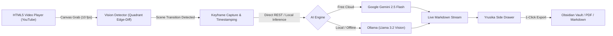

# Yrusika — Open-Source AI Video Note Taker & Visual Transcriber

An open-source, subscription-free alternative to proprietary video note-taking tools. Yrusika docks directly into YouTube, Coursera, and any HTML5 video player, runs real-time in-browser computer-vision scene detection, captures high-resolution keyframes, and transcribes code, math formulas, and architectural diagrams into structured Markdown using Google Gemini 2.5 Flash or local Ollama models.

---

## Key Features

* **Side-by-Side Video Docking:** Automatically resizes and docks alongside YouTube and video players with clean split-screen controls.
* **In-Browser Scene Detection:** Uses quadrant edge-difference computer vision (`quadrant-edge-diff`) on an HTML5 canvas to detect whiteboard, terminal, and slide updates with zero server latency.
* **Direct AI Integration (Zero Paywalls):**
  * **Google Gemini 2.5 Flash:** Bring your own free Google AI Studio key (1,500 requests/day free tier).
  * **Local Ollama:** Run offline with zero API calls using `llama3.2-vision` or `minicpm-v`.
* **Technical Lecture Transcriptions:**
  * Clean syntax-highlighted code blocks (`go`, `python`, `rust`, `bash`, `sql`).
  * KaTeX math formulas (`$...$` and `$$...$$`).
  * Architecture mindmaps and flowcharts in Mermaid.js syntax.
* **Timestamp Badges & Jump Links:** Every note card includes a burned timestamp badge; clicking a card seeks the video player directly to that second.
* **Obsidian & File System Integration:** Link directly to a local Obsidian vault directory or export notes to Markdown, PDF, Word, or plain text with one click.
* **YouTube Ad Intelligence:** Automatically pauses note capture during mid-roll ads and resumes once the lecture content returns.
* **20 Signature Color Palettes (Dark & Light Modes):** Seamless theme switcher featuring 20 curated color palettes (Corporate SaaS Blue, Emerald & Mint Forest, Sunset Violet & Peach, Ocean Breeze & Teal, Nordic Slate & Frost, Cyberpunk Neon, Retro Mustard & Espresso, Royal Rose Gold, and more) with custom CSS variables and one-click "Surprise Me" randomization.
* **Video Playback Dock:** Overlay controls for 0.8x / 1.5x speed, 10s scrub, play/pause, volume toggle, and fullscreen focus mode.

---

## Architecture



---

## Installation

### Prerequisites
* Google Chrome, Brave, Arc, Edge, or any Chromium-based browser.
* A free [Google AI Studio API Key](https://aistudio.google.com/) (or a running local instance of [Ollama](https://ollama.ai/)).

### Steps

1. **Clone the repository:**
   ```bash
   git clone https://github.com/tejuas98/yrusika.git
   ```

2. **Load into Chrome:**
   * Open Chrome and navigate to `chrome://extensions/`.
   * Enable **Developer mode** in the top right toggle.
   * Click **Load unpacked** in the top left toolbar.
   * Select the cloned `yrusika` directory.

3. **Configure Your Model:**
   * Click the extension icon or right-click and select **Options**.
   * Choose your provider:
     * **Google Gemini:** Paste your API key and select `gemini-2.5-flash`.
     * **Local Ollama:** Select Ollama and set endpoint (default `http://localhost:11434`) and model (`llama3.2-vision`).
   * Click **Save Configuration**.

---

## How to Use

1. Navigate to any lecture on YouTube (for example, an engineering lecture, coding tutorial, or math walkthrough).
2. The **Yrusika** side panel opens docked to the right of the video player.
3. Click the bottom red record button `[ ● EN ▾ ]` to start auto-watching.
4. As the instructor writes code or changes slides, Yrusika captures the keyframe and writes timestamped notes.
5. To take an instant manual snapshot at any point, click the Camera icon `[ 📷 ]` in the bottom dock.
6. When finished, click the **Export** icon at the top of the panel to save as **Markdown (.md)** or **PDF**.

---

## Feature Comparison

| Capability | Proprietary Extensions | Yrusika (Open Source) |
| :--- | :--- | :--- |
| **Pricing** | Subscription / 20 min free trial | **100% Free & Open Source (MIT)** |
| **AI Backend** | Closed proprietary cloud | **Google Gemini 2.5 Flash / Local Ollama** |
| **API Key Freedom** | Locked to vendor | **Bring Your Own Key (BYOK) / Local** |
| **Continuous Watching** | Hard paywalled quota | **Unlimited (subject only to free Gemini/local limits)** |
| **Data Privacy** | Video sent to third-party cloud | **Direct connection to Google or 100% offline via Ollama** |
| **Exports** | Markdown, PDF, Word | **Markdown, PDF, Word, Clipboard, Obsidian** |
| **Scene Detection** | Quadrant Edge / Histogram | **Client-side Quadrant Edge-Diff** |

---

## Contributing

Contributions, bug reports, and pull requests are welcome!

1. Fork the Project
2. Create your Feature Branch (`git checkout -b feature/AmazingFeature`)
3. Commit your Changes (`git commit -m 'Add some AmazingFeature'`)
4. Push to the Branch (`git push origin feature/AmazingFeature`)
5. Open a Pull Request

---

## License

Distributed under the MIT License. See `LICENSE` for more information.
